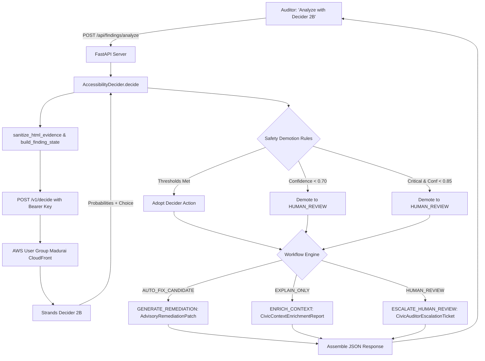

# REUSABLE DECISION PATTERN: #policy

> **Pattern Category**: `#policy`  
> **Model Target**: Strands Decider 2B (`strands-decider-2b-hobson-v19`)  
> **Endpoint Contract**: Hosted `POST /v1/decide` (Bearer Auth) or Local `POST /v1/systemone`  
> **Primary File**: [`accesslens/decider.py`](file:///C:/Users/cvard/Desktop/TestForge%20AI-awshackthon/AccessLens-AI/accesslens/decider.py) & [`accesslens/workflow.py`](file:///C:/Users/cvard/Desktop/TestForge%20AI-awshackthon/AccessLens-AI/accesslens/workflow.py)  
> **Hackathon Credit**: Built with the AWS User Group Madurai Strands Decider hackathon kit  

---

## 1. Executive Summary & Problem Context

In automated web accessibility engineering, running a scanner like `axe-core` on a webpage produces dozens or hundreds of discrete violation nodes. In civic and public-service software—such as scholarship portals, citizen identity forms, pension enrollment pages, and welfare benefits applications—**blind automated code modifications are exceptionally dangerous**:
- Replacing an empty image alt text automatically might inject generic placeholder text (`alt="image"`) that actively misleads blind citizens attempting to identify official state seals or security graphics.
- Modifying brand colors or buttons automatically to satisfy contrast ratios can break departmental visual hierarchy or violate statutory brand identity guidelines.
- Altering form controls or ARIA attributes without semantic understanding can render vital civic forms completely unusable for screen reader users.

The decision of **what action to take** for a specific accessibility violation is therefore a high-stakes **policy decision**:
1. Can this finding be repaired automatically with zero risk to semantics (`AUTO_FIX_CANDIDATE` -> `GENERATE_REMEDIATION`)?
2. Does this finding require structural DOM context enrichment before any decision is made (`EXPLAIN_ONLY` -> `ENRICH_CONTEXT`)?
3. Is this barrier too critical, brand-sensitive, or ambiguous, requiring human manual review (`HUMAN_REVIEW` -> `ESCALATE_HUMAN_REVIEW`)?

AccessLens AI: Civic Access Auditor formalizes this triage policy into a reusable Strands Decider 2B decision pattern labeled **`#policy`**.

---

## 2. State Provided to the Decider

The decision state is bounded, privacy-safe, and structured to prevent context bloat while giving the 2B model sufficient technical context.

### State Construction Function
Implemented in `accesslens.decider.build_finding_state(...)`:

```python
def build_finding_state(
    rule_id: str,
    impact: str,
    description: str,
    target: list[str] | str,
    html: str,
    failure_summary: str,
) -> str:
    clean_target = ", ".join(target) if isinstance(target, list) else str(target)
    clean_html = sanitize_html_evidence(html, max_chars=300)
    clean_summary = " ".join((failure_summary or "").split())[:250]

    return (
        f"ACCESSIBILITY AUDIT FINDING:\n"
        f"- Rule ID: {rule_id.strip()}\n"
        f"- Severity Impact: {impact.strip().lower()}\n"
        f"- Description: {description.strip()[:200]}\n"
        f"- CSS Target: {clean_target[:150]}\n"
        f"- Element Evidence: {clean_html}\n"
        f"- Failure Summary: {clean_summary}"
    )
```

### Privacy & Sanitization Defenses (`sanitize_html_evidence`)
- **Length bounded**: HTML evidence is capped at $\le 300$ characters.
- **Script & Style stripping**: `<script>` and `<style>` blocks are regex-excised.
- **Token redaction**: Query parameters matching `token=`, `key=`, `secret=`, `password=`, `auth=` are replaced with `[REDACTED]`.
- **Whitespace normalization**: Consecutive whitespace and carriage returns are collapsed into single spaces.

### Example Wire State
```text
ACCESSIBILITY AUDIT FINDING:
- Rule ID: image-alt
- Severity Impact: critical
- Description: Ensures  elements have alternate text or a role of none or presentation
- CSS Target: #main-content > header.banner > img#civic-seal-graphic
- Element Evidence: 
- Failure Summary: Fix any of the following: Element does not have an alt attribute
```

---

## 3. Typed Questions and Permitted Options

The decision question adheres strictly to the Strands Decider schema specification, defining two typed questions evaluated in a single forward pass:

```python
{
    "action": {
        "type": "choice",
        "instructions": (
            "Based on the accessibility violation rule, severity, and HTML snippet, "
            "what is the recommended remediation action?"
        ),
        "criteria": {
            "AUTO_FIX_CANDIDATE": (
                "Unambiguous deterministic fix that has minimal risk of breaking page semantics "
                "or requiring design decisions (such as adding alt attribute to standalone images "
                "or associating a form label with an id)"
            ),
            "EXPLAIN_ONLY": (
                "Clear context and educational guidance, but automated code generation is risky "
                "or involves subjective design choices"
            ),
            "HUMAN_REVIEW": (
                "High impact or critical barrier, complex ARIA widget roles, color contrast changes "
                "involving brand palette, or ambiguous context requiring manual human judgment"
            ),
        },
    },
    "risk_level": {
        "type": "score",
        "instructions": "Rate the technical and visual risk of modifying this element automatically:",
        "criteria": ["low", "medium", "high", "critical"],
    },
}
```

### Permitted Values & Semantics

| Question | Type | Permitted Values | Semantic Role |
|---|---|---|---|
| `action` | `choice` | `AUTO_FIX_CANDIDATE` | Safe for automated code patching (e.g. missing `alt=""`, `<label for>`). |
| | | `EXPLAIN_ONLY` | Advisory guidance for developers; automated edit is risky. |
| | | `HUMAN_REVIEW` | Manual inspection required; barrier is critical or design-sensitive. |
| `risk_level` | `score` | `low`, `medium`, `high`, `critical` | Quantitative risk evaluation of modifying the target node. |

---

## 4. Wiring into the Execution Flow



---

## 5. Three Distinct Downstream Execution Paths

The Decider's output directly governs genuine downstream behavior in [`accesslens/workflow.py`](file:///C:/Users/cvard/Desktop/TestForge%20AI-awshackthon/AccessLens-AI/accesslens/workflow.py):

### Path 1: `GENERATE_REMEDIATION` (Advisory Code Patch)
- **Trigger**: `action == "AUTO_FIX_CANDIDATE"` and confidence $\ge 85\%$ for critical/serious or $\ge 70\%$ for moderate/minor.
- **Output**: Returns an `AdvisoryRemediationPatch`:
  - Concrete corrected HTML snippet strictly grounded in the element evidence.
  - Verification checklist for developers (e.g. axe-core re-scan, keyboard tab check).
  - Explicit statutory notice: *“Advisory recommendation only. Code was not modified or verified on the live website. Automated tools must not mutate production civic systems without developer sign-off.”*

### Path 2: `ENRICH_CONTEXT` (DOM Container & Landmark Analysis)
- **Trigger**: `action == "EXPLAIN_ONLY"` or evidence sufficiency indicates surrounding context is required.
- **Output**: Returns a `CivicContextEnrichmentReport`:
  - In-memory structural inspection of parent container (`form_group`, `tabular_data_structure`, `navigation_bar`, `primary_content_region`).
  - Surrounding W3C landmark identification (`form`, `navigation`, `main`, `contentinfo`).
  - Specific contextual notes guiding civic engineers on form layout and cognitive clarity.

### Path 3: `ESCALATE_HUMAN_REVIEW` (Auditor Escalation Ticket)
- **Trigger**: `action == "HUMAN_REVIEW"` or confidence below safety thresholds or high risk score.
- **Output**: Returns a `CivicAuditorEscalationTicket`:
  - Unique ticket identifier (`ESC-XXXXXXXX`).
  - Categorized civic impact area (e.g. *Citizen Applications & Public Benefit Forms*, *Citizen Authentication*, *Low-Vision Information Access*).
  - 4-step manual testing protocol:
    1. Screen Reader Protocol (NVDA, JAWS, VoiceOver).
    2. Keyboard-Only Navigation & Focus Indicator verification.
    3. Plain-Language & Statutory Notice clarity check.
    4. 200% and 400% Zoom Reflow verification.
  - Statutory notice explaining that automated testing covers only a subset of WCAG criteria and human auditor sign-off is legally required.

---

## 6. Confidence Thresholds & Conservative Safety Gates

Because accessibility barriers directly impact people with disabilities, false positives and risky automated modifications cannot be tolerated. The pattern enforces multi-tier conservative safety gates:

### 1. Base Confidence Threshold (`DECIDER_CONFIDENCE_THRESHOLD = 0.70`)
If the model's confidence for the winning choice is below $70\%$, the action is automatically overridden to `HUMAN_REVIEW`:
```python
if confidence < self.config.confidence_threshold:
    effective_action = "HUMAN_REVIEW"
    rationale = f"Decider confidence ({confidence:.0%}) is below safety threshold (70%); routed to human review."
```

### 2. High-Severity Penalty Guard ($85\%$ for Critical / Serious)
Even if Decider 2B classifies a `critical` or `serious` violation as `AUTO_FIX_CANDIDATE`, it must demonstrate $\ge 85\%$ confidence. Otherwise, it is downgraded to `HUMAN_REVIEW`:
```python
elif clean_impact in ("critical", "serious") and effective_action == "AUTO_FIX_CANDIDATE":
    if confidence < 0.85:
        effective_action = "HUMAN_REVIEW"
        rationale = f"Finding has {clean_impact.upper()} severity; candidate demoted to HUMAN_REVIEW because confidence < 85%."
```

### 3. Graceful Failure & Offline Fallback
- **Missing API Key (`HTTP 401`)**: Raises `DeciderAuthError`, prompting configuration while keeping the audit workflow completely functional.
- **Quota Exhaustion (`HTTP 402`)**: Raises `DeciderQuotaError`, advising offline static analysis.
- **Rate Limit (`HTTP 429`)**: Raises `DeciderRateLimitError` with advisory cooldown.
- **Network Outage / Gateway Error (`HTTP 503`, timeouts)**: Raises `DeciderUnavailableError`.
- In all error scenarios, the system **never crashes** and defaults safely to `HUMAN_REVIEW` with deterministic static WCAG guidance.

---

## 7. How Another Developer Can Reuse This Pattern

Any Python application, CI/CD linter, or PR triage bot can import and reuse this decision pattern in 5 lines of code:

```python
from accesslens.decider import AccessibilityDecider, DeciderError
from accesslens.workflow import execute_workflow

# 1. Instantiate client (reads DECIDER_URL and DECIDER_API_KEY from environment)
decider = AccessibilityDecider()

# 2. Submit accessibility finding
try:
    decision = decider.decide(
        rule_id="image-alt",
        impact="critical",
        description="Images must have alternate text",
        target=["#hero-banner img"],
        html='',
        failure_summary="Element does not have an alt attribute",
    )

    # 3. Execute downstream workflow based on Decider 2B triage
    workflow_result = execute_workflow(
        decision=decision,
        rule_id="image-alt",
        impact="critical",
        description="Images must have alternate text",
        target=["#hero-banner img"],
        html='',
        failure_summary="Element does not have an alt attribute",
        static_guidance={},
    )

    if workflow_result.workflow_action == "GENERATE_REMEDIATION":
        print(f"[CI BOT] Advisory Patch: {workflow_result.remediation_patch.proposed_remediation}")
    elif workflow_result.workflow_action == "ESCALATE_HUMAN_REVIEW":
        print(f"[CI BOT] Escalation Ticket: {workflow_result.escalation_ticket.ticket_id}")
    else:
        print(f"[CI BOT] Context Enriched: {workflow_result.context_enrichment.detected_container}")

except DeciderError as err:
    print(f"[FALLBACK] Decider unavailable ({err}); routing to manual QA triage.")
```

---

## 8. Tags & Metadata
- **Pattern Category**: `#policy`
- **Model Tag**: `#strands-decider-2b`
- **Kit Credit**: Built with the AWS User Group Madurai Strands Decider hackathon kit
